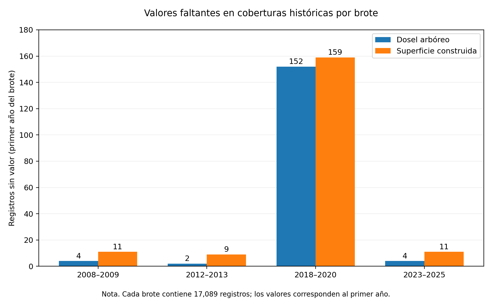
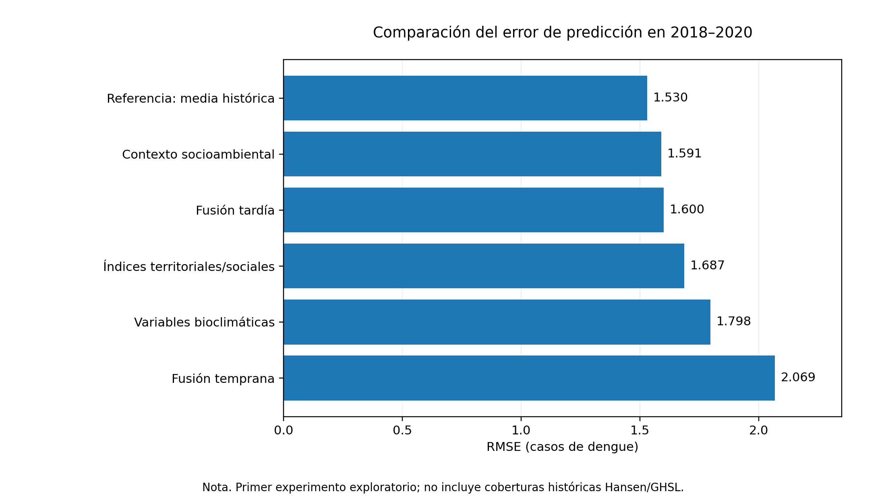

# Análisis de datos de dengue en Xalapa

## Descripción del proyecto
Este proyecto presenta un análisis de datos
relacionados con el dengue en Xalapa, Veracruz,
utilizando herramientas de Ciencia de Datos.

## Objetivo
Explorar los datos disponibles, identificar
patrones y desarrollar modelos para el
análisis del dengue.

## Datos utilizados
El archivo `datos/dengue_xalapa_2016_2024.xlsx`
contiene la base de datos utilizada en el proyecto.

## Metodología
El trabajo se desarrolla mediante las siguientes etapas:

1. Revisión y preparación de los datos.
2. Análisis exploratorio.
3. Identificación y tratamiento de datos faltantes.
4. Construcción y evaluación de modelos.
5. Visualización e interpretación de resultados.

## Herramientas
- Python
- Google Colab
- Jupyter Notebook

## Organización del repositorio
- `datos/`: base de datos del proyecto.
- `notebooks/`: cuaderno de Python con el proceso de análisis.
- `resultados/`: gráficas obtenidas durante el análisis.

## Visualización de resultados

### Datos faltantes y cobertura

### Evaluación del primer experimento

## Autores
Proyecto académico de Ciencia de Datos
